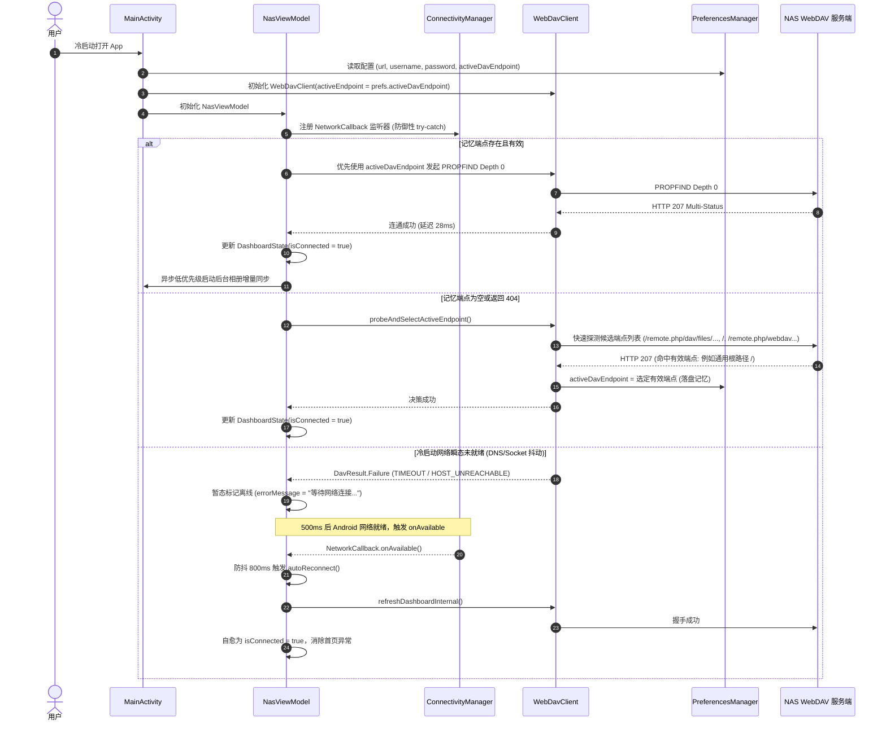

# 4D 侦察与架构全息契约规范 (Contract)

**版本**: v1.0.6 (Auto-Healing & Adaptive WebDAV Recon)  
**审阅机构**: Hermes 深度调研组 (Researcher)  
**目标定位**: 彻底根除冷启动连接假死、网络竞争风暴、通用 WebDAV/反向代理 404、端点记忆缺失等顽疾。

---

## 一、 现场检查证据链与根本原因归因 (Root Cause Analysis)

经对代码库现场穿透排查与代码调用链静态审查，导致“冷启动或重开 App 不会自动连接、首页红字报错、必须进设置点保存才连接”的问题存在 **三大互为因果的核心诱因**：

### 1.1 WebDAV 端点硬编码 Nextcloud 路径死锁 (通用 WebDAV / 反代直接 404)
- **缺陷位置**: `WebDavClient.kt:230-245` (`DavUrlNormalizer.buildDavUrl`) 与 `WebDavClient.kt:354-356` (`getDavUrl`)
- **证据与现场复盘**:
  ```kotlin
  // WebDavClient.kt 现存逻辑
  val rootPrefix = when {
      !customRootPrefix.isNullOrBlank() -> customRootPrefix.trimEnd('/')
      hasCustomPath(cleanBase) -> cleanBase
      else -> "$cleanBase/remote.php/dav/files/$encodedUser"
  }
  ```
  在 `WebDavClient.getDavUrl()` 中，`customRootPrefix` 参数永远为 `null`。当用户配置反向代理直接反代根路径（如 `https://nas.example.com`）或通用 WebDAV 服务（群晖 Synology WebDAV Server、AList 挂载根目录、Nginx `dav_methods`、Caddy、TrueNAS 等裸域名/IP 时）：
  1. `hasCustomPath` 研判为 `false`；
  2. 强制拼接路径为 `https://domain.com/remote.php/dav/files/admin/`；
  3. 通用 WebDAV 服务端因不存在 Nextcloud 专有目录结构，直接抛出 **HTTP 404 Not Found**；
  4. 系统未设计端点回退探测，直接将 404 判定为连接失败。

### 1.2 冷启动双发网络握手风暴与协程 Job 粗暴竞争
- **缺陷位置**: `MainActivity.kt:66-71` 与 `NasViewModel.kt:105-116`
- **证据与现场复盘**:
  ```kotlin
  // MainActivity.kt
  override fun onCreate(savedInstanceState: Bundle?) {
      ...
      viewModel = NasViewModel(this, prefs, webDavClient, syncManager)
      lifecycleScope.launch {
          if (prefs.password.isNotEmpty()) {
              syncManager.performForegroundIncrementalSync()
              viewModel.refreshAll()
          }
      }
  ```
  ```kotlin
  // NasViewModel.kt
  init {
      startTrafficMonitoring()
      if (prefs.password.isNotEmpty()) {
          refreshAll()
      }
  }
  ```
  1. **首毫秒并发争抢**: `NasViewModel.init` 抢先调度 `refreshAll()` 发起看板网络探测；与此同时 `MainActivity` 的 `lifecycleScope` 立即拉起 `performForegroundIncrementalSync()` 占用 `webDavClient` 发起媒体比对与上传；
  2. **Socket 抖动与握手失败**: 移动端冷启动时底层网络（DNS 缓存、TLS 会话）可能需要 200~800ms 建立稳定连接。首个网络请求一旦遭遇短暂超时或域名未解析，`refreshDashboardInternal` 捕获异常并将仪表盘标记为 `isConnected = false` 与“无法解析 NAS 域名 / 网络连接超时”；
  3. **Job 暴力重置**: 当相册增量同步协程完成后，在 `lifecycleScope` 又触发了一次 `viewModel.refreshAll()`，该调用将 ViewModel 内部正在执行的 Job 直接 `cancel()`，造成网络中断和页面闪烁；
  4. **失败后彻底躺平**: 系统未注册任何动态网络事件监听器，首次失败后没有任何自愈或重试机制，界面永远停滞在错误红字。

### 1.3 用户在“设置页保存”得以恢复的心理错觉实质
- 当用户看到首页连接失败后，点进设置打开弹窗并点击“直接保存”时，系统已度过了冷启动网络未就绪阶段（网络已畅通）；
- 点击保存触发了 `viewModel.refreshAll()`，此时网络正常故而连接成功；
- 用户因此误以为“App 冷启动被死锁，必须进设置点保存才生效”，实则是 **冷启动瞬态失败缺乏自愈 + 缺少有效端点持久化记忆** 造成的体验假象。

---

## 二、 架构拓扑与时序流转规范 (Architecture & Flow)

### 2.1 整体组件交互拓扑
```
┌──────────────────────────────────────────────────────────────────────────────────┐
│                             Android 操作系统环境                                  │
│                 (ConnectivityManager / NetworkCallback)                          │
└────────────────────────┬─────────────────────────────────────────────────────────┘
                         │ 监听网络恢复 (onAvailable / NET_CAPABILITY_VALIDATED)
                         ▼
┌──────────────────────────────────────────────────────────────────────────────────┐
│                                 NasViewModel                                     │
│  ┌─────────────────────────┐   ┌──────────────────────────┐                      │
│  │ NetworkAutoRecovery     │   │ TrafficStats Monitor     │                      │
│  │ (800ms 防抖自愈重连)     │   │ (1s UID 流量采样)        │                      │
│  └───────────┬─────────────┘   └──────────────────────────┘                      │
│              │                                                                   │
│              │ 1. 优先拉取仪表盘与自适应探测                                      │
│              ▼                                                                   │
│  ┌─────────────────────────┐   3. 连通后低优先级后台唤起   ┌───────────────────────┐│
│  │ refreshDashboardInternal├─────────────────────────────►│ SyncManager           ││
│  └───────────┬─────────────┘                              │ (前台增量同步)        ││
│              │                                            └───────────────────────┘│
└──────────────┼───────────────────────────────────────────────────────────────────┘
               │ 2. 探活与多端点决策
               ▼
┌──────────────────────────────────────────────────────────────────────────────────┐
│                                WebDavClient                                      │
│  ┌────────────────────────────────────────────────────────────────────────────┐  │
│  │ probeAndSelectActiveEndpoint()                                             │  │
│  │  - 优先验证 PreferencesManager.activeDavEndpoint 记忆端点                  │  │
│  │  - 记忆失效/为空时，拉取 DavUrlNormalizer.getCandidateEndpoints() 竞速探活   │  │
│  │  - 成功端点热写内存并在 PreferencesManager 中持久化落盘                    │  │
│  └────────────────────────────────────────────────────────────────────────────┘  │
└──────────────────────────────────────┬───────────────────────────────────────────┘
                                       │
                                       ▼
                       RFC 4918 WebDAV 远端 NAS 实例
       (Nextcloud 现代标准 / 群晖 WebDAV / AList / Nginx / Caddy 根路径)
```

### 2.2 冷启动与网络自愈时序图


---

## 三、 接口与字段全息契约规范 (Contract Signatures)

### 3.1 仪表盘综合状态契约 (`DashboardState`)
```kotlin
package com.taolesi.nas.ui.viewmodel

import com.taolesi.nas.data.SpeedSourceMode
import com.taolesi.nas.net.StorageQuota

data class DashboardState(
    // --- 既有字段保持 100% 向后兼容 ---
    val quota: StorageQuota = StorageQuota(0, 0, 0),
    val fileCount: Int = 0,
    val pingMs: Long = -1L,
    val isConnected: Boolean = false,
    val networkLabel: String = "未连接",
    val isLoading: Boolean = false,
    val errorMessage: String? = null,
    val downloadSpeedText: String = "0 B/s",
    val uploadSpeedText: String = "0 B/s",

    // --- 高级可视化与服务器遥测指标 ---
    val speedSourceMode: SpeedSourceMode = SpeedSourceMode.SERVER_BANDWIDTH,
    val storageDistribution: StorageDistribution = StorageDistribution.EMPTY,
    val serverTelemetry: ServerTelemetry = ServerTelemetry.EMPTY
)
```

### 3.2 `PreferencesManager.kt` 契约扩充

```kotlin
// 文件路径: app/src/main/java/com/taolesi/nas/data/PreferencesManager.kt

class PreferencesManager(context: Context) {
    // ... 保持既有属性完全不变 ...

    /**
     * 当前探测并激活的有效 WebDAV 端点全路径
     * 例如:
     * - Nextcloud: "https://nas.example.com/remote.php/dav/files/admin"
     * - 通用根路径: "https://nas.example.com"
     * - 自定义路径: "http://192.168.1.100:5005/webdav"
     * 若未探测或用户修改了 serverUrl/username，该值为空字符串 ""
     */
    var activeDavEndpoint: String
        get() = sharedPrefs.getString(KEY_ACTIVE_DAV_ENDPOINT, "") ?: ""
        set(value) = sharedPrefs.edit().putString(KEY_ACTIVE_DAV_ENDPOINT, value.trimEnd('/')).apply()

    companion object {
        // ... 既有常量 ...
        private const val KEY_ACTIVE_DAV_ENDPOINT = "active_dav_endpoint"
    }
}
```

### 3.3 `WebDavClient.kt` 契约扩充与端点模型

```kotlin
// 文件路径: app/src/main/java/com/taolesi/nas/net/WebDavClient.kt

/**
 * 不可变原子配置模型扩充
 */
data class WebDavConfig(
    val rawBaseUrl: String,
    val cleanBaseUrl: String,
    val username: String,
    val password: String,
    val isConfigured: Boolean,
    val activeEndpoint: String = "" // 新增：当前记忆/选中的活跃有效端点
) {
    val basicAuthHeader: String = if (isConfigured) {
        Credentials.basic(username, password, Charsets.UTF_8)
    } else {
        ""
    }

    companion object {
        fun create(
            url: String, 
            user: String, 
            pass: String, 
            activeEndpoint: String = ""
        ): WebDavConfig {
            val cleanUrl = DavUrlNormalizer.cleanBaseUrl(url)
            val trimmedUser = user.trim()
            val isConfigured = cleanUrl.isNotBlank() && trimmedUser.isNotBlank() && pass.isNotBlank()
            return WebDavConfig(
                rawBaseUrl = url,
                cleanBaseUrl = cleanUrl,
                username = trimmedUser,
                password = pass,
                isConfigured = isConfigured,
                activeEndpoint = activeEndpoint.trimEnd('/')
            )
        }

        fun empty(): WebDavConfig = WebDavConfig("", "", "", "", false, "")
    }
}

/**
 * DavUrlNormalizer 扩充候选端点生成
 */
object DavUrlNormalizer {
    // ... 保持现有 cleanBaseUrl, hasCustomPath, encodeSegment 完全向后兼容 ...

    /**
     * 根据 BaseURL 与用户名智能生成 WebDAV 候选端点探测序列
     * 规则:
     * 1. 若 URL 本身已带有自定义路径 (hasCustomPath 为 true)，首选且仅首推该自定义路径；
     * 2. 若为裸域名/根路径，按生态优先级输出候选列表:
     *    - Candidate 1: Nextcloud 现代标准路径: $cleanBase/remote.php/dav/files/$encodedUser
     *    - Candidate 2: 通用根路径 WebDAV (Synology/AList/Nginx/Caddy/反代根): $cleanBase
     *    - Candidate 3: Nextcloud/ownCloud 经典路径: $cleanBase/remote.php/webdav
     *    - Candidate 4: 常用 /dav 路径: $cleanBase/dav
     *    - Candidate 5: 常用 /webdav 路径: $cleanBase/webdav
     */
    fun getCandidateEndpoints(baseUrl: String, username: String): List<String> {
        val cleanBase = cleanBaseUrl(baseUrl)
        if (cleanBase.isEmpty()) return emptyList()
        val encodedUser = encodeSegment(username)

        if (hasCustomPath(cleanBase)) {
            return listOf(cleanBase)
        }

        return listOf(
            "$cleanBase/remote.php/dav/files/$encodedUser",
            cleanBase,
            "$cleanBase/remote.php/webdav",
            "$cleanBase/dav",
            "$cleanBase/webdav"
        ).distinct()
    }

    /**
     * 保持既有 buildDavUrl 签名与行为 100% 兼容
     */
    fun buildDavUrl(
        baseUrl: String,
        username: String,
        subPath: String = "",
        isCollection: Boolean = false,
        customRootPrefix: String? = null
    ): String { ... }
}

/**
 * WebDavClient 核心方法扩充
 */
class WebDavClient(
    baseUrl: String,
    user: String,
    pass: String,
    initialActiveEndpoint: String = "" // 构造兼容
) {
    private val configRef = AtomicReference(
        WebDavConfig.create(baseUrl, user, pass, initialActiveEndpoint)
    )

    /**
     * 暴露当前激活的活跃端点
     */
    val activeDavEndpoint: String get() = configRef.get().activeEndpoint

    /**
     * 动态设置活跃端点
     */
    fun setActiveEndpoint(endpoint: String) {
        val current = configRef.get()
        configRef.set(current.copy(activeEndpoint = endpoint.trimEnd('/')))
    }

    /**
     * 动态更新配置（支持同步更新或重置活跃端点）
     */
    fun updateConfig(url: String, username: String, password: String, activeEndpoint: String = "") {
        configRef.set(WebDavConfig.create(url, username, password, activeEndpoint))
    }

    /**
     * 构建业务完整 URL: 优先使用 activeEndpoint 作为 customRootPrefix
     */
    fun getDavUrl(subPath: String = "", isCollection: Boolean = false): String {
        val config = configRef.get()
        return DavUrlNormalizer.buildDavUrl(
            baseUrl = config.cleanBaseUrl,
            username = config.username,
            subPath = subPath,
            isCollection = isCollection,
            customRootPrefix = config.activeEndpoint.ifEmpty { null }
        )
    }

    /**
     * 自适应多端点探活与自动决策
     */
    suspend fun probeAndSelectActiveEndpoint(): DavResult<String> = withContext(Dispatchers.IO) {
        val config = configRef.get()
        if (!config.isConfigured) {
            return@withContext DavResult.Failure(DavErrorType.CREDENTIALS_MISSING, "未配置服务器地址或凭据")
        }

        // Step 1: 验证已有 activeEndpoint
        if (config.activeEndpoint.isNotBlank()) {
            val verifyResult = testSingleEndpoint(config.activeEndpoint)
            if (verifyResult is DavResult.Success) {
                return@withContext DavResult.Success(config.activeEndpoint)
            }
        }

        // Step 2: 遍历候选端点
        val candidates = DavUrlNormalizer.getCandidateEndpoints(config.cleanBaseUrl, config.username)
        var lastFailure: DavResult.Failure? = null

        for (candidate in candidates) {
            when (val res = testSingleEndpoint(candidate)) {
                is DavResult.Success -> {
                    setActiveEndpoint(candidate)
                    return@withContext DavResult.Success(candidate)
                }
                is DavResult.Failure -> {
                    lastFailure = res
                    if (res.errorType == DavErrorType.AUTH_FAILED) {
                        setActiveEndpoint(candidate)
                        return@withContext res
                    }
                }
            }
        }

        return@withContext lastFailure ?: DavResult.Failure(DavErrorType.NOT_FOUND, "未能发现兼容的 WebDAV 服务端点")
    }

    private fun testSingleEndpoint(endpointUrl: String): DavResult<Long> { ... }
}
```

### 3.4 `NasViewModel.kt` 网络自愈与调度解耦契约

```kotlin
// 文件路径: app/src/main/java/com/taolesi/nas/ui/viewmodel/NasViewModel.kt

class NasViewModel(
    private val context: Context,
    val prefs: PreferencesManager,
    val webDavClient: WebDavClient,
    val syncManager: SyncManager
) : ViewModel() {

    private var networkCallback: ConnectivityManager.NetworkCallback? = null
    private var autoReconnectJob: Job? = null

    init {
        startTrafficMonitoring()
        registerNetworkAutoRecovery()

        if (prefs.password.isEmpty()) {
            _dashboardState.value = DashboardState(
                isConnected = false,
                networkLabel = "未配置密码",
                errorMessage = "请在设置中配置 NAS 连接密码",
                isLoading = false
            )
            _photosState.value = ResourceState.Error("请在设置中配置 NAS 连接密码")
            _videosState.value = ResourceState.Error("请在设置中配置 NAS 连接密码")
            _filesState.value = ResourceState.Error("请在设置中配置 NAS 连接密码")
        } else {
            // 恢复持久化的活跃端点
            if (prefs.activeDavEndpoint.isNotBlank()) {
                webDavClient.setActiveEndpoint(prefs.activeDavEndpoint)
            }
            refreshAll()
        }
    }

    /**
     * 注册 Android 原生网络恢复监听器 (支持单元测试与非 Android 环境安全防御)
     */
    private fun registerNetworkAutoRecovery() {
        try {
            val cm = context.getSystemService(Context.CONNECTIVITY_SERVICE) as? ConnectivityManager ?: return
            val callback = object : ConnectivityManager.NetworkCallback() {
                override fun onAvailable(network: Network) {
                    triggerAutoReconnectDebounced()
                }

                override fun onCapabilitiesChanged(network: Network, caps: NetworkCapabilities) {
                    if (caps.hasCapability(NetworkCapabilities.NET_CAPABILITY_INTERNET) &&
                        caps.hasCapability(NetworkCapabilities.NET_CAPABILITY_VALIDATED)) {
                        triggerAutoReconnectDebounced()
                    }
                }
            }
            cm.registerDefaultNetworkCallback(callback)
            networkCallback = callback
        } catch (_: Throwable) {
            // JVM 单元测试或无网络服务环境安全捕获，严禁崩溃
        }
    }

    /**
     * 防抖自愈重连 (Debounced Auto-Reconnect)
     */
    fun triggerAutoReconnectDebounced() {
        if (prefs.password.isEmpty()) return
        if (_dashboardState.value.isConnected) return

        autoReconnectJob?.cancel()
        autoReconnectJob = viewModelScope.launch {
            delay(800L)
            if (!_dashboardState.value.isConnected && prefs.password.isNotEmpty()) {
                refreshAll()
            }
        }
    }

    /**
     * 仪表盘刷新流程升级: 集成自适应多端点探活与有效端点落盘
     */
    private suspend fun refreshDashboardInternal() {
        _dashboardState.value = _dashboardState.value.copy(isLoading = true, errorMessage = null)
        val startTime = System.currentTimeMillis()

        try {
            // 1. 若尚未激活端点，确保端点自适应决策就绪
            if (webDavClient.activeDavEndpoint.isEmpty()) {
                val probeRes = webDavClient.probeAndSelectActiveEndpoint()
                if (probeRes is DavResult.Success) {
                    prefs.activeDavEndpoint = probeRes.data
                }
            }

            // 2. 发起配额与根目录获取
            val (quota, rootItems) = withTimeout(10000L) {
                withContext(Dispatchers.IO) {
                    val r = webDavClient.listFolder("")
                    val q = try {
                        webDavClient.getStorageQuota()
                    } catch (_: Exception) {
                        StorageQuota(usedBytes = 0L, availableBytes = -3L, totalBytes = 0L, isUnlimited = true)
                    }
                    q to r
                }
            }
            val latency = System.currentTimeMillis() - startTime

            // 连接成功，更新活跃端点持久化
            if (webDavClient.activeDavEndpoint.isNotEmpty() && prefs.activeDavEndpoint != webDavClient.activeDavEndpoint) {
                prefs.activeDavEndpoint = webDavClient.activeDavEndpoint
            }

            _dashboardState.value = DashboardState(
                quota = quota,
                fileCount = rootItems.size,
                pingMs = latency,
                isConnected = true,
                networkLabel = if (latency < 100) "极速专线直连 (${latency}ms)" else "专线正常 (${latency}ms)",
                isLoading = false,
                errorMessage = null,
                downloadSpeedText = _dashboardState.value.downloadSpeedText,
                uploadSpeedText = _dashboardState.value.uploadSpeedText
            )

            // 3. 核心解耦：连通成功后，在后台静默发起相册增量同步，彻底消除冷启动争抢
            triggerSilentBackgroundSync()

        } catch (e: Exception) {
            // 若遇到 404 或 405，可能服务端端点发生了变迁，清空记忆触发重试探测
            if (e.message?.contains("404") == true || e.message?.contains("405") == true) {
                prefs.activeDavEndpoint = ""
            }

            val errorMsg = parseErrorMessage(e)
            _dashboardState.value = DashboardState(
                quota = StorageQuota(0L, 0L, 0L),
                fileCount = 0,
                pingMs = -1L,
                isConnected = false,
                networkLabel = "连接失败",
                isLoading = false,
                errorMessage = errorMsg,
                downloadSpeedText = "0 B/s",
                uploadSpeedText = "0 B/s"
            )
        }
    }

    private fun triggerSilentBackgroundSync() {
        viewModelScope.launch(Dispatchers.IO) {
            try {
                syncManager.performForegroundIncrementalSync()
            } catch (_: Throwable) {}
        }
    }

    override fun onCleared() {
        super.onCleared()
        autoReconnectJob?.cancel()
        try {
            val cm = context.getSystemService(Context.CONNECTIVITY_SERVICE) as? ConnectivityManager
            networkCallback?.let { cm?.unregisterNetworkCallback(it) }
        } catch (_: Throwable) {}
    }
}
```

### 3.5 `MainActivity.kt` 冷启动调度解耦契约

```kotlin
// 文件路径: app/src/main/java/com/taolesi/nas/MainActivity.kt

override fun onCreate(savedInstanceState: Bundle?) {
    super.onCreate(savedInstanceState)
    enableEdgeToEdge()

    prefs = PreferencesManager(this)
    // 注入持久化的 activeDavEndpoint
    webDavClient = WebDavClient(prefs.serverUrl, prefs.username, prefs.password, prefs.activeDavEndpoint)
    syncManager = SyncManager(this, prefs, webDavClient)
    viewModel = NasViewModel(this, prefs, webDavClient, syncManager)

    // 【冷启动彻底解耦契约】:
    // 坚决废除 onCreate 立即并发 syncManager.performForegroundIncrementalSync() 与 viewModel.refreshAll() 的死锁逻辑！
    // 调度全权交由 ViewModel 的生命周期与自适应探测管理，消除网络握手竞争。

    setContent {
        NASTheme {
            MainAppHost(
                viewModel = viewModel,
                onDirectOpen = { fileName, relativeDir ->
                    directOpenFile(fileName, relativeDir)
                }
            )
        }
    }
}
```

---

## 四、 边界处理与暗坑防御 (Fail-Safe Matrix)

| 场景序号 | 边缘/极端场景 | 潜伏危害与历史暗坑 | 契约防御与安全落地机制 |
|---|---|---|---|
| **E-01** | JVM 单元测试环境执行 | `ConnectivityManager` 未 Mock 导致测试用例崩溃 | 注册与注销必须包裹在全局 `try-catch` 中，失败安全降级，不阻断任何单元测试。 |
| **E-02** | 用户修改 NAS 地址或用户名 | 旧端点记忆失效，向新主机请求错误路径报 404 | 保存配置时比对 `url` 与 `username`，若变动立即清空 `activeDavEndpoint`，触发自适应探活。 |
| **E-03** | 手机断网冷启动 (飞行模式) | 首个请求直接报 Host Unreachable，App 永久红字 | 状态置为等待网络；注册 `NetworkCallback`，飞行模式关闭或 Wi-Fi 连接瞬间自动防抖自愈。 |
| **E-04** | 服务端改动（Nextcloud 切换为 AList） | 记忆端点返回 404，后续所有请求持续崩溃 | 当请求遭遇 404/405 时，清空本地 `activeDavEndpoint`，自动降级触发重新探活。 |
| **E-05** | 空密码启动 (首次安装) | 发送探测请求导致客户端 IP 被 fail2ban 拉黑 | `prefs.password.isEmpty()` 保持 Fail-Fast 铁律，坚决禁止发起任何探测与网络请求。 |
| **E-06** | 弱网环境下 Wi-Fi 与 5G 频繁跳变 | 产生高频重连协程风暴，消耗流量与电量 | `triggerAutoReconnectDebounced` 设定 800ms 防抖，前一个重连 Job 自动取消，仅保留最新一次。 |

---

## 五、 下游工兵 (Workers) 零损耗分工与消费清单

下游工兵在根据本契约进行具体代码修改时，应按以下正交切口消费执行：

### 🛠️ 工兵 Worker 1: 存储与网络底层 (Data & Net Core)
- **负责文件**:
  1. `app/src/main/java/com/taolesi/nas/data/PreferencesManager.kt`
  2. `app/src/main/java/com/taolesi/nas/net/WebDavClient.kt`
- **落盘任务**:
  1. 在 `PreferencesManager` 中新增 `activeDavEndpoint` 的加密读写持久化；
  2. 在 `DavUrlNormalizer` 中新增 `getCandidateEndpoints()`，并确保现有 `buildDavUrl`、`cleanBaseUrl` 100% 兼容；
  3. 在 `WebDavClient` 中落地 `activeDavEndpoint` 属性、`setActiveEndpoint()`，实现 `probeAndSelectActiveEndpoint()` 候选自适应探活；
  4. 升级 `getDavUrl()`，优先使用已激活的 `activeDavEndpoint`。

### 🛠️ 工兵 Worker 2: ViewModel 响应式与自愈系统 (ViewModel & Auto-Healing)
- **负责文件**:
  1. `app/src/main/java/com/taolesi/nas/ui/viewmodel/NasViewModel.kt`
- **落盘任务**:
  1. 在 `NasViewModel` 中实现 `registerNetworkAutoRecovery()` 与 `NetworkCallback`，防抖自愈重连；
  2. 重构 `refreshDashboardInternal`，融合自适应端点探活与有效端点落盘；
  3. 解耦相册增量同步调度，连接成功后静默拉起，消除冷启动并发争抢；
  4. 在 `onCleared()` 中安全注销回调，杜绝内存泄漏。

### 🛠️ 工兵 Worker 3: 主入口调度与连接交互 (MainActivity & Dialog)
- **负责文件**:
  1. `app/src/main/java/com/taolesi/nas/MainActivity.kt`
- **落盘任务**:
  1. 清理 `MainActivity.onCreate` 中冷启动强发 `performForegroundIncrementalSync()` 的竞态代码；
  2. `WebDavClient` 初始化时传入持久化的 `prefs.activeDavEndpoint`；
  3. `ConnectionConfigDialog` 在就地测试和保存时接入端点更新与重置逻辑。

---

## 六、 质检与单测守护方案 (Verification Matrix)

在修改完成后，必须运行并全部通过以下验收验证：
1. **单元测试回归守护**:
   - `WebDavClientTest.kt`: 必须保证既有 `cleanBaseUrl`、`buildDavUrl`、`hasCustomPath` 等测试 100% 通过；
   - `ReviewerVerificationProbeTest.kt`: 必须保证 4 项诉求全部断言 100% 通过；
   - `TrafficStatsProbeTest.kt`: 必须保证流量统计防御性兜底测试 100% 通过；
2. **新增探活与端点单测**:
   - 验证 `getCandidateEndpoints` 针对裸域名生成 5 个按优先级排列的候选端点；
   - 验证自定义路径（如 `/dav`）直接作为首选且不重复；
   - 验证 `activeDavEndpoint` 注入后 `getDavUrl` 成功以其为根前缀；
3. **Gradle 指令实测**:
   ```bash
   ./gradlew testDebugUnitTest
   ```
   输出必须为 `BUILD SUCCESSFUL`，零编译警告中断。
