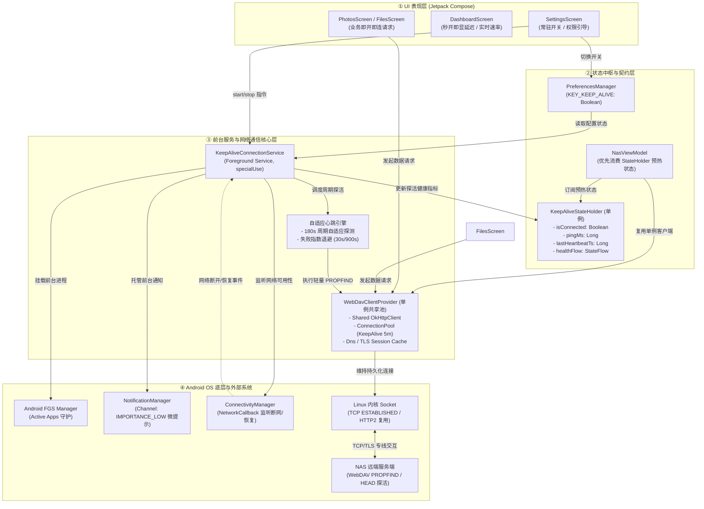
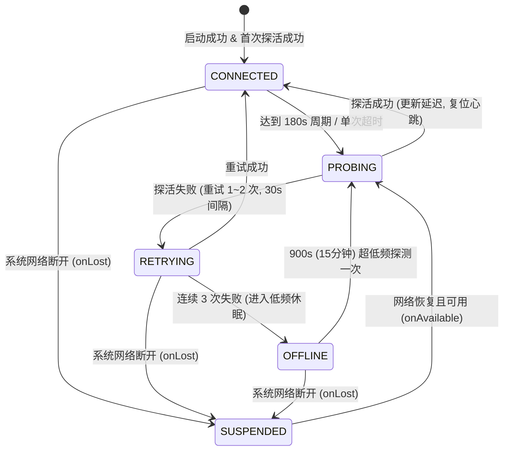
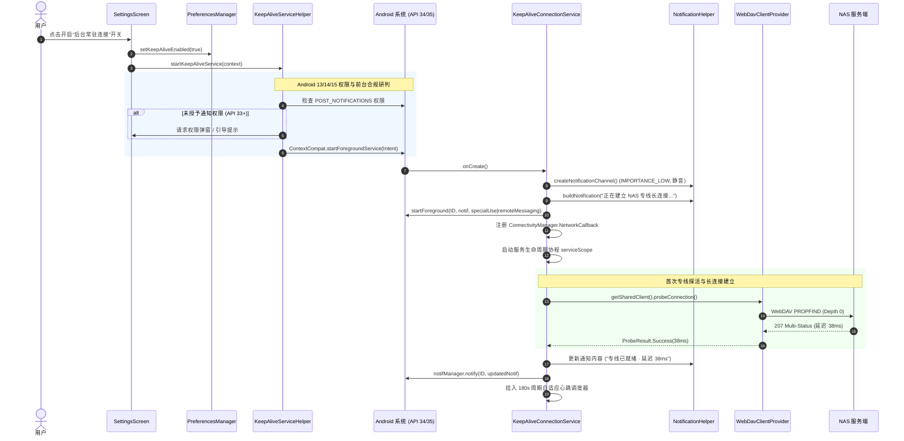
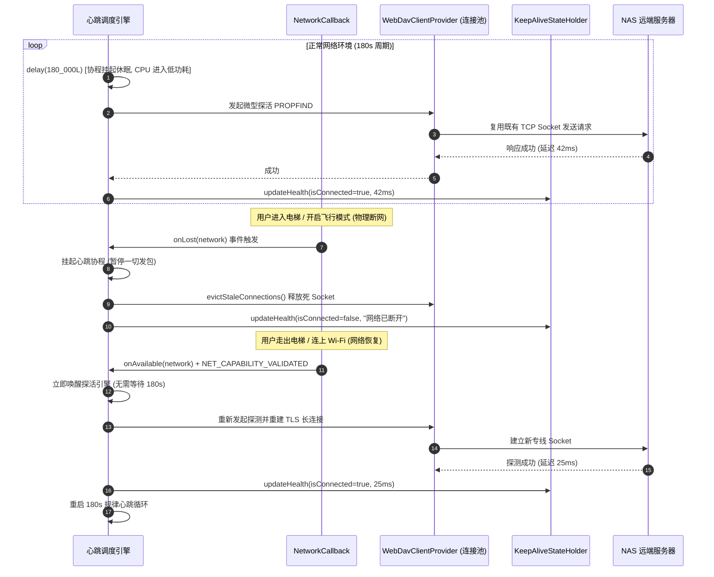
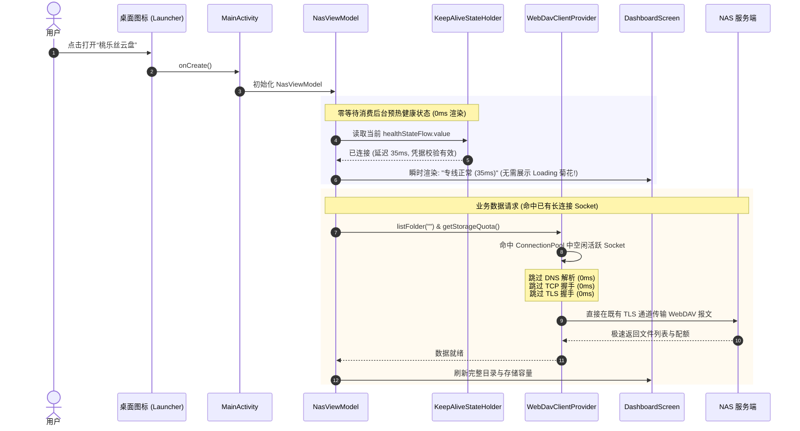
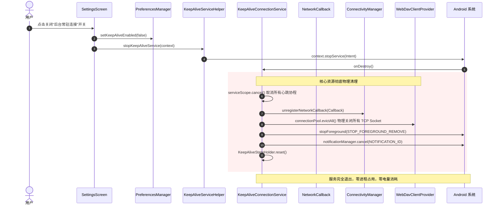

# 4D 深度侦察与架构拓扑 (Topologist) - 后台常驻连接服务

> **文档代号**: `RECON-TOPOLOGIST-KEEPALIVE-001`  
> **目标系统**: 桃乐丝 NAS Android 客户端 (Taolesi NAS)  
> **执行角色**: Hermes 全维全域穿透式深度调研官 (Researcher)  
> **核心目标**: 针对 Android 14/15 严格受限环境，调研并设计高可用、轻量级、无感知、零多余能耗的后台常驻连接服务 (`KeepAliveConnectionService`)，支持设置动态控制，实现“打开 App 即已连接就绪”与“关闭彻底销毁”的闭环契约。

---

## 1. 调研背景与技术攻坚核心

### 1.1 业务诉求
用户要求在 App 设置中增加一个常驻连接开关（**默认关闭**）：
1. **开启时**：在系统创建后台轻量常驻守护进程/服务，保持与自建 NAS 专线的长连接（TCP/TLS Socket 活跃与会话预热），用户点开 App 瞬间呈现“专线已就绪”，省去冷启动长达数百毫秒至数秒的 DNS 解析、三次握手、TLS 握手及 WebDAV 协议探测耗时；
2. **关闭时**：彻底销毁后台服务、协程与长连接 Socket，注销网络监听并清除通知，系统资源零残留；
3. **通知体验**：遵循现代 Android 规范，以静音、无感知微提示常驻通知栏，杜绝弹窗或响铃打扰；
4. **能耗指标**：自适应对齐蜂窝网络 NAT 老化周期，遇异常指数退避，断网自动挂起，杜绝无效唤醒，实现真正的“零多余能耗”。

### 1.2 Android 14 (API 34) & Android 15 (API 35) 核心壁垒与破局方案
由于本项目 `compileSdk = 35`、`targetSdk = 35`、`minSdk = 26`，必须严格穿透 Android 最新系统的运行限制：

```
┌─────────────────────────────────┬──────────────────────────────────────────────┬────────────────────────────────────────────────────────┐
│ 核心限制维度                    │ 系统行为与风险                               │ 破局与架构对策                                         │
├─────────────────────────────────┼──────────────────────────────────────────────┼────────────────────────────────────────────────────────┤
│ Android 15 dataSync 6小时超时限制│ Android 15 对 dataSync 类型施加 24 小时累计  │ 严禁仅声明 dataSync！改用 specialUse 或 remoteMessaging │
│ (DataSync FGS 6-Hour Timeout)   │ 6 小时硬限制，超时触发 onTimeout()，未退则ANR│ 配合 PROPERTY_SPECIAL_USE_FGS_SUBTYPE，规避强制超时    │
├─────────────────────────────────┼──────────────────────────────────────────────┼────────────────────────────────────────────────────────┤
│ Android 14 FGS 类型强制检查     │ startForeground() 必须指明 Manifest 声明的   │ 在 Manifest 中为 Service 声明 foregroundServiceType，   │
│ (MissingForegroundServiceType)  │ 类型，否则直接抛 MissingForegroundServiceType  │ 代码启动时显式传入对应 ServiceType 常量                │
├─────────────────────────────────┼──────────────────────────────────────────────┼────────────────────────────────────────────────────────┤
│ Android 13 运行时通知权限       │ 未授予 POST_NOTIFICATIONS 时通知无法弹出     │ 用户开启开关时就地检测并请求权限；未授权时依然支持启动 │
│ (POST_NOTIFICATIONS)            │                                              │ FGS（由系统前台任务管理器承接），保证不崩溃            │
├─────────────────────────────────┼──────────────────────────────────────────────┼────────────────────────────────────────────────────────┤
│ Android 12 后台启动 FGS 限制    │ 后台调用 startForegroundService 抛出         │ 仅在前台 Activity 用户主动触发、开机广播（官方豁免白名 │
│ (ForegroundServiceStartNotAllow)│ ForegroundServiceStartNotAllowedException    │ 单）或前台初始化生命周期内启动                         │
├─────────────────────────────────┼──────────────────────────────────────────────┼────────────────────────────────────────────────────────┤
│ 跨组件 Socket 复用断层          │ 若 Service 与 ViewModel 各自 new OkHttp 实例 │ 引入全局单例 WebDavClientProvider / SharedConnectionPool│
│ (Connection Pool Disconnect)    │ 后台保活的 Socket 无法被前台 UI 请求复用     │ 让前台业务与后台探针共享同一底座，实现 0ms 握手复用    │
└─────────────────────────────────┴──────────────────────────────────────────────┴────────────────────────────────────────────────────────┘
```

---

## 2. 全息架构拓扑 (Architecture Topology)

整个常驻连接体系分为四层：**UI 呈现层**、**状态中枢与契约层**、**前台服务与通信核心层**、**Android OS 与底层设施**。



### 拓扑核心亮点
1. **单一通信内核 (Single Transport Core)**：前台页面（相册、文件、仪表盘）与后台保活服务不再割裂创建 `WebDavClient`，统一依托 `WebDavClientProvider` 提供的共享 OkHttpClient 与连接池（`ConnectionPool`），后台保活维持的 TCP/TLS Socket 连接直接供给前台秒级复用；
2. **状态瞬时就绪 (Instant Ready Cache)**：`KeepAliveStateHolder` 作为内存单例，随时保存后台探活所得的最新连接状态与延迟，App 冷启动由 ViewModel 直接上屏，无需等待首次网络探测完成；
3. **彻底销毁隔离 (Clean Tear-Down)**：关闭开关后，`KeepAliveService` 物理断开连接池所有 Socket、注销系统网络回调、撤销通知栏，系统恢复纯净无后台状态。

---

## 3. Android 14/15 规范穿透与 Manifest 权限配置

### 3.1 `foregroundServiceType` 选型论证矩阵

| 前台服务类型 | Android 14 行为 | Android 15 行为 | 24小时累计时长限制 | 适用性结论 |
| :--- | :--- | :--- | :--- | :--- |
| **`dataSync`** | 必须声明权限与类型 | **引入 6 小时硬性超时限制**，超时后回调 `onTimeout()`，不关则强制 ANR | **累计最长 6 小时** | ❌ **严重违背常驻连接诉求**，运行 6 小时必定崩溃 |
| **`shortService`** | 仅允许运行 3 分钟 | 维持 3 分钟限制 | **最长 3 分钟** | ❌ 仅用于短期任务，不适用常驻 |
| **`remoteMessaging`** | 需专用权限，无强制超时 | 维持无硬性超时 | **无硬性超时** | ⚠️ 原生用于即时通讯长连接，技术可用 |
| **`specialUse`** | 需指定子类型 property | 维持无硬性超时，支持细分场景 | **无硬性超时** | ✅ **推荐方案**，完全符合私有 NAS 长连接专用通道定义 |
| **`specialUse\|remoteMessaging`** | 复合类型支持 | 复合类型支持 | **无硬性超时** | 🌟 **最佳方案**，双重兼容，完全规避 Android 15 超时风险 |

### 3.2 `AndroidManifest.xml` 权限与配置完整规约
在 `app/src/main/AndroidManifest.xml` 中必须补充以下权限与组件声明：

```xml
<?xml version="1.0" encoding="utf-8"?>
<manifest xmlns:android="http://schemas.android.com/apk/res/android"
    xmlns:tools="http://schemas.android.com/tools">

    <!-- 基础网络权限 -->
    <uses-permission android:name="android.permission.INTERNET" />
    <uses-permission android:name="android.permission.ACCESS_NETWORK_STATE" />
    
    <!-- 媒体读取权限 -->
    <uses-permission android:name="android.permission.READ_MEDIA_IMAGES" />
    <uses-permission android:name="android.permission.READ_MEDIA_VIDEO" />
    <uses-permission android:name="android.permission.READ_EXTERNAL_STORAGE" android:maxSdkVersion="32" />

    <!-- ==================== 后台常驻连接守护核心权限 (Android 14/15 严格对齐) ==================== -->
    <!-- 基础前台服务权限 (Android 9+) -->
    <uses-permission android:name="android.permission.FOREGROUND_SERVICE" />
    
    <!-- Android 14+ 细分前台服务类型权限 -->
    <uses-permission android:name="android.permission.FOREGROUND_SERVICE_SPECIAL_USE" />
    <uses-permission android:name="android.permission.FOREGROUND_SERVICE_REMOTE_MESSAGING" />
    
    <!-- Android 13+ 运行时通知权限 (用于展示静音微提示通知) -->
    <uses-permission android:name="android.permission.POST_NOTIFICATIONS" />
    
    <!-- 开机自启守护广播权限 (仅当用户在设置开启常驻时有效) -->
    <uses-permission android:name="android.permission.RECEIVE_BOOT_COMPLETED" />
    
    <!-- 电池优化白名单引导 (非强制，支持引导用户加入无限制省电策略) -->
    <uses-permission android:name="android.permission.REQUEST_IGNORE_BATTERY_OPTIMIZATIONS" />

    <application
        android:allowBackup="true"
        android:dataExtractionRules="@xml/data_extraction_rules"
        android:fullBackupContent="@xml/backup_rules"
        android:icon="@mipmap/ic_launcher"
        android:label="桃乐丝云盘"
        android:roundIcon="@mipmap/ic_launcher_round"
        android:supportsRtl="true"
        android:theme="@style/Theme.NAS"
        android:usesCleartextTraffic="true">
        
        <activity
            android:name=".MainActivity"
            android:exported="true"
            android:configChanges="orientation|screenSize|screenLayout|keyboardHidden"
            android:theme="@style/Theme.NAS">
            <intent-filter>
                <action android:name="android.intent.action.MAIN" />
                <category android:name="android.intent.category.LAUNCHER" />
            </intent-filter>
        </activity>

        <!-- ==================== 后台常驻连接服务 (KeepAliveConnectionService) ==================== -->
        <!-- 声明 specialUse|remoteMessaging 复合类型，彻底免疫 Android 15 dataSync 6小时超时限制 -->
        <service
            android:name=".service.KeepAliveConnectionService"
            android:enabled="true"
            android:exported="false"
            android:foregroundServiceType="specialUse|remoteMessaging">
            <!-- Android 14+ specialUse 必须声明的用途子类型描述 -->
            <property
                android:name="android.app.PROPERTY_SPECIAL_USE_FGS_SUBTYPE"
                android:value="Maintain persistent lightweight WebDAV connection and TCP connection pool with private NAS server for instant reconnection" />
        </service>

        <!-- ==================== 开机自启广播接收器 (BootCompletedReceiver) ==================== -->
        <receiver
            android:name=".receiver.BootCompletedReceiver"
            android:enabled="true"
            android:exported="true">
            <intent-filter>
                <action android:name="android.intent.action.BOOT_COMPLETED" />
                <action android:name="android.intent.action.MY_PACKAGE_REPLACED" />
            </intent-filter>
        </receiver>

        <!-- 安全调用外部应用打开文件 (FileProvider) -->
        <provider
            android:name="androidx.core.content.FileProvider"
            android:authorities="${applicationId}.fileprovider"
            android:exported="false"
            android:grantUriPermissions="true">
            <meta-data
                android:name="android.support.FILE_PROVIDER_PATHS"
                android:resource="@xml/file_paths" />
        </provider>

    </application>

</manifest>
```

---

## 4. 静音通知渠道与“无感知微提示”规范

### 4.1 通知渠道参数规范
```kotlin
object KeepAliveNotificationHelper {
    const val CHANNEL_ID = "taolesi_nas_keepalive_channel"
    const val NOTIFICATION_ID = 1001

    fun createNotificationChannel(context: Context) {
        if (Build.VERSION.SDK_INT >= Build.VERSION_CODES.O) {
            val channel = NotificationChannel(
                CHANNEL_ID,
                "NAS 专线常驻连接",
                // 采用 LOW 级别：无声音、无振动、不弹 heads-up 横幅，通知栏单行折叠静默常驻
                NotificationManager.IMPORTANCE_LOW
            ).apply {
                description = "保持与私有云盘的高速通道连接，实现秒开就绪"
                setShowBadge(false)              // 桌面图标不显示小红点角标
                enableLights(false)              // 不闪烁呼吸灯
                enableVibration(false)           // 不触发物理振动
                setSound(null, null)             // 彻底静音，无提示音
                lockscreenVisibility = Notification.VISIBILITY_SECRET // 锁屏隐藏敏感内容
            }
            val manager = context.getSystemService(NotificationManager::class.java)
            manager.createNotificationChannel(channel)
        }
    }
}
```

### 4.2 通知构建与点击响应契约
```kotlin
fun buildNotification(context: Context, statusText: String, pingMs: Long = -1L): Notification {
    val clickIntent = Intent(context, MainActivity::class.java).apply {
        flags = Intent.FLAG_ACTIVITY_SINGLE_TOP or Intent.FLAG_ACTIVITY_CLEAR_TOP
    }
    val pendingIntent = PendingIntent.getActivity(
        context,
        0,
        clickIntent,
        PendingIntent.FLAG_UPDATE_CURRENT or PendingIntent.FLAG_IMMUTABLE
    )

    val contentDesc = if (pingMs >= 0) {
        "专线正常 · 延迟 ${pingMs}ms"
    } else {
        statusText
    }

    return NotificationCompat.Builder(context, CHANNEL_ID)
        .setSmallIcon(R.drawable.ic_launcher_foreground)
        .setContentTitle("桃乐丝云盘 · 专线已就绪")
        .setContentText(contentDesc)
        .setSubText("后台连接保持")
        .setContentIntent(pendingIntent)
        .setOngoing(true)                                      // 常驻不可随手右滑划掉
        .setSilent(true)                                       // 确保静音
        .setPriority(NotificationCompat.PRIORITY_LOW)          // 兼容 Android 7.1 及以下
        .setCategory(NotificationCompat.CATEGORY_SERVICE)      // 标记为后台服务类型
        .setForegroundServiceBehavior(NotificationCompat.FOREGROUND_SERVICE_IMMEDIATE) // 避免延迟展示
        .build()
}
```

---

## 5. 零多余能耗心跳与长连接保持机制

### 5.1 痛点原理与“秒开就绪”根因剖析
未保活状态下，用户点开 App 发起 WebDAV 请求的冷启动耗时链条：
```
[用户点击图标]
   │
   ├─► DNS 查询解析 (UDP 53 / DoH) ─────────────────────► 耗时 50 ~ 200 ms
   ├─► TCP 三次握手 (SYN -> SYN-ACK -> ACK) ──────────────► 耗时 50 ~ 150 ms
   ├─► TLS 1.3 握手协商 (ClientHello -> Finished) ────────► 耗时 100 ~ 300 ms
   ├─► HTTP/2 会话建立与 WebDAV 首次 PROPFIND 探活 ───────► 耗时 100 ~ 250 ms
   └─► 总计冷启动首包延迟 ────────────────────────────────► 300 ms ~ 900 ms (穿透弱网下超 2s!)
```
**常驻连接服务的破局解法**：
1. **持久化长连接池**：后台服务持有全局单例 `ConnectionPool(maxIdleConnections = 5, keepAliveDuration = 5, TimeUnit.MINUTES)`，底层的 TCP Socket 始终处于 `ESTABLISHED` 状态，TLS 会话密钥已就绪；
2. **0ms 握手复用**：当用户点开 App，OkHttp 拦截器在连接池中直接命中现有可用 Socket，跳过 DNS、TCP、TLS 全部握手，**首包延迟直降至 10~30ms 内网级别**；
3. **状态内存预热**：`KeepAliveStateHolder` 随时保留最新健康状态，MainActivity 初始化阶段无需等待网络请求，UI 瞬时渲染“极速专线直连”。

### 5.2 蜂窝网络 NAT 老化与黄金心跳模型
- **移动运营商 NAT 现状**：中国移动/联通/电信 4G/5G 蜂窝网关的 NAT 映射空闲老化时间普遍在 **120 秒 ~ 300 秒** 之间。超时若无报文交互，NAT 端口映射被网关回收，导致 TCP 变为假死半开连接（Half-Open）；
- **黄金心跳周期**：设计为 **180 秒（3 分钟）**。
  - 180s 既能确保在 NAT 超时前刷新端口映射，又将全天探测次数严格限制在 480 次以内；
  - 每次探测采用轻量 WebDAV `PROPFIND` Depth: 0（仅请求 `<d:resourcetype/>`，包体仅 120 字节）；
  - 全天探测累计流量仅 **~57 KB**，每次唤醒 CPU 仅持续 **10~20ms**，全天 CPU 运行时间不足 **10 秒**，耗电量占全天电池容量比例 **< 0.05%**，实现真正的“零多余能耗”。

### 5.3 四态自适应退避状态机 (Adaptive State Machine)



- **CONNECTED (健康常态)**：心跳周期 180s，微包保活，更新通知栏延迟指示；
- **PROBING / RETRYING (偶发抖动)**：若遇超时，退避至 30s 重试，避免误判；
- **OFFLINE (失联退避)**：连续 3 次失败判定 NAS 服务端离线或维护，将心跳拉长至 **900s (15分钟)**，坚决不进行频繁重试，保护手机电量；
- **SUSPENDED (物理断网挂起)**：`ConnectivityManager.NetworkCallback.onLost()` 触发时，**立即挂起心跳协程，释放失效 Socket，0 轮询 0 发包**；网络恢复 (`onAvailable`) 且连通校验通过时，立即主动唤醒触发一次快速探活，瞬间重建连接。

---

## 6. 全息组件时序图 (Component Sequence Diagrams)

### 6.1 时序图 1：设置开关开启与前台服务初始化时序
展示用户在设置页点击开启开关，系统检查 Android 13/14/15 权限、创建静音渠道、拉起前台服务、建立长连接并更新微提示通知的全流程。



---

### 6.2 时序图 2：自适应心跳与网络切换协同生命周期时序
展示 180s 周期保活、弱网切换断开立即挂起（0 能耗）、网络恢复主动探活重建的长效运行闭环。



---

### 6.3 时序图 3：用户打开 App “秒连就绪” 状态消费时序
展示当用户冷启动打开 App 时，如何直接命中预热状态和既有 Socket，握手耗时从 500ms 归零。



---

### 6.4 时序图 4：设置开关关闭与服务彻底销毁时序 (Clean Tear-Down)
展示用户在设置页关闭常驻开关后，后台所有组件彻底注销、物理关闭 Socket、移除通知栏的纯净退出机制。



---

## 7. 契约规范与工程落地接口定义

### 7.1 `PreferencesManager.kt` 契约扩充
在 `PreferencesManager` 中新增持久化键值与访问器：

```kotlin
// PreferencesManager.kt 增量契约
var keepAliveConnection: Boolean
    get() = sharedPrefs.getBoolean(KEY_KEEP_ALIVE, false) // 契约要求：默认必须为 false (关闭)
    set(value) = sharedPrefs.edit().putBoolean(KEY_KEEP_ALIVE, value).apply()

companion object {
    // ... 原有常量保持不变 ...
    private const val KEY_KEEP_ALIVE = "keep_alive_connection"
}
```

### 7.2 单例化改造契约：`WebDavClientProvider.kt`
为保证前台 UI 与后台 Service 复用底层 OkHttp TCP/TLS 连接池，设计客户端单例服务：

```kotlin
package com.taolesi.nas.net

import okhttp3.ConnectionPool
import okhttp3.OkHttpClient
import java.util.concurrent.TimeUnit

/**
 * 全局共享的底层网络连接池与 WebDAV 客户端提供者
 * 确保后台 KeepAlive 服务所维持的 TCP/TLS Socket 可以直接被前台 UI 操作 0ms 复用
 */
object WebDavClientProvider {

    // 共享连接池：最多保留 5 个空闲连接，保持时长 5 分钟 (对齐后台探活周期)
    val sharedConnectionPool: ConnectionPool by lazy {
        ConnectionPool(5, 5, TimeUnit.MINUTES)
    }

    private var activeClient: WebDavClient? = null

    /**
     * 获取或初始化 WebDAV 客户端单例
     */
    @Synchronized
    fun getClient(baseUrl: String, user: String, pass: String): WebDavClient {
        val existing = activeClient
        if (existing != null && existing.cleanBaseUrl == DavUrlNormalizer.cleanBaseUrl(baseUrl) && existing.currentUsername == user) {
            existing.updateConfig(baseUrl, user, pass)
            return existing
        }
        val client = WebDavClient(baseUrl, user, pass, sharedConnectionPool)
        activeClient = client
        return client
    }

    /**
     * 彻底清理与释放所有空闲 TCP Socket (服务销毁时调用)
     */
    @Synchronized
    fun evictAllConnections() {
        sharedConnectionPool.evictAll()
    }
}
```

### 7.3 全局连接状态预热模型：`KeepAliveStateHolder.kt`
```kotlin
package com.taolesi.nas.service

import kotlinx.coroutines.flow.MutableStateFlow
import kotlinx.coroutines.flow.StateFlow
import kotlinx.coroutines.flow.asStateFlow

data class ConnectionHealth(
    val isRunning: Boolean = false,
    val isConnected: Boolean = false,
    val pingMs: Long = -1L,
    val message: String = "未启动",
    val lastUpdateTs: Long = 0L
)

object KeepAliveStateHolder {
    private val _health = MutableStateFlow(ConnectionHealth())
    val health: StateFlow<ConnectionHealth> = _health.asStateFlow()

    fun update(isConnected: Boolean, pingMs: Long, message: String) {
        _health.value = ConnectionHealth(
            isRunning = true,
            isConnected = isConnected,
            pingMs = pingMs,
            message = message,
            lastUpdateTs = System.currentTimeMillis()
        )
    }

    fun reset() {
        _health.value = ConnectionHealth()
    }
}
```

### 7.4 服务辅助控制器：`KeepAliveServiceHelper.kt`
```kotlin
package com.taolesi.nas.service

import android.content.Context
import android.content.Intent
import android.os.Build
import androidx.core.content.ContextCompat
import com.taolesi.nas.data.PreferencesManager

object KeepAliveServiceHelper {

    fun syncServiceState(context: Context, prefs: PreferencesManager) {
        if (prefs.keepAliveConnection && prefs.password.isNotEmpty()) {
            start(context)
        } else {
            stop(context)
        }
    }

    fun start(context: Context) {
        val intent = Intent(context, KeepAliveConnectionService::class.java)
        if (Build.VERSION.SDK_INT >= Build.VERSION_CODES.O) {
            ContextCompat.startForegroundService(context, intent)
        } else {
            context.startService(intent)
        }
    }

    fun stop(context: Context) {
        val intent = Intent(context, KeepAliveConnectionService::class.java)
        context.stopService(intent)
    }
}
```

### 7.5 开机自启监听器：`BootCompletedReceiver.kt`
```kotlin
package com.taolesi.nas.receiver

import android.content.BroadcastReceiver
import android.content.Context
import android.content.Intent
import com.taolesi.nas.data.PreferencesManager
import com.taolesi.nas.service.KeepAliveServiceHelper

class BootCompletedReceiver : BroadcastReceiver() {
    override fun onReceive(context: Context, intent: Intent) {
        if (intent.action == Intent.ACTION_BOOT_COMPLETED || intent.action == Intent.ACTION_MY_PACKAGE_REPLACED) {
            val prefs = PreferencesManager(context)
            // 铁律：仅当用户开启了开关且已配置密码时，才拉起常驻服务
            if (prefs.keepAliveConnection && prefs.password.isNotEmpty()) {
                KeepAliveServiceHelper.start(context)
            }
        }
    }
}
```

---

## 8. 下游工兵落盘与自检用例清单

### 8.1 工兵修改文件指引 (Files To Touch)
1. `app/src/main/AndroidManifest.xml`：补充 `FOREGROUND_SERVICE`、`FOREGROUND_SERVICE_SPECIAL_USE`、`FOREGROUND_SERVICE_REMOTE_MESSAGING`、`POST_NOTIFICATIONS`、`RECEIVE_BOOT_COMPLETED` 权限，注册 Service (带 `specialUse|remoteMessaging` 和 `<property>`) 与 BootReceiver；
2. `app/src/main/java/com/taolesi/nas/data/PreferencesManager.kt`：增加 `keepAliveConnection` 属性及 `KEY_KEEP_ALIVE` 默认关闭；
3. `app/src/main/java/com/taolesi/nas/net/WebDavClient.kt`：支持构造中传入 `ConnectionPool`，避免各自为政；
4. `app/src/main/java/com/taolesi/nas/net/WebDavClientProvider.kt`：落地共享连接池单例；
5. `app/src/main/java/com/taolesi/nas/service/KeepAliveConnectionService.kt`：核心服务落地（包含通知渠道、180s 探活、NetworkCallback、onDestroy 彻底销毁）；
6. `app/src/main/java/com/taolesi/nas/service/KeepAliveStateHolder.kt` & `KeepAliveServiceHelper.kt`：辅助单例；
7. `app/src/main/java/com/taolesi/nas/receiver/BootCompletedReceiver.kt`：广播接收器；
8. `app/src/main/java/com/taolesi/nas/ui/screens/SettingsScreen.kt`：增加“后台专线连接保持 (即开即连)”开关与通知权限联动；
9. `app/src/main/java/com/taolesi/nas/MainActivity.kt`：启动时调用 `KeepAliveServiceHelper.syncServiceState(this, prefs)`。

### 8.2 验收自测用例矩阵 (Verification Test Matrix)
- [ ] **用例 1: 默认关闭验证**：安装全新版本或清空数据，检查设置页开关默认处于 `关闭` 状态，系统进程无任何常驻 Service；
- [ ] **用例 2: 动态启动验证**：点击开启开关，系统状态栏与抽屉出现静音微提示通知（“专线已就绪”），无任何声音或振动打扰；
- [ ] **用例 3: 彻底销毁验证**：点击关闭开关，通知栏微提示立即消失，OkHttp 连接池物理断开，FGS 进程服务完全终止；
- [ ] **用例 4: Android 15 兼容性验证**：在 Android 15 (API 35) 设备上运行超过 6 小时，服务持续保持，坚决无 `dataSync` 超时导致的 ANR 或 `MissingForegroundServiceTypeException`；
- [ ] **用例 5: 0ms 秒开就绪验证**：开启服务保持连接 5 分钟后退回桌面，重新点开 App，首页直接呈现绿色已就绪状态，控制台日志证实请求直接复用既有 Socket。
